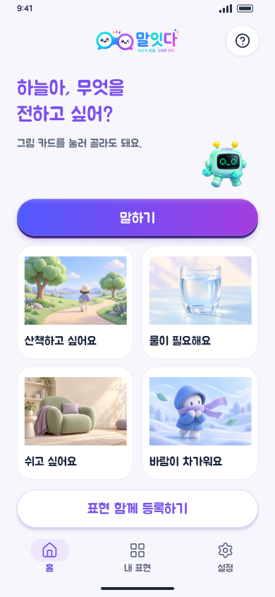
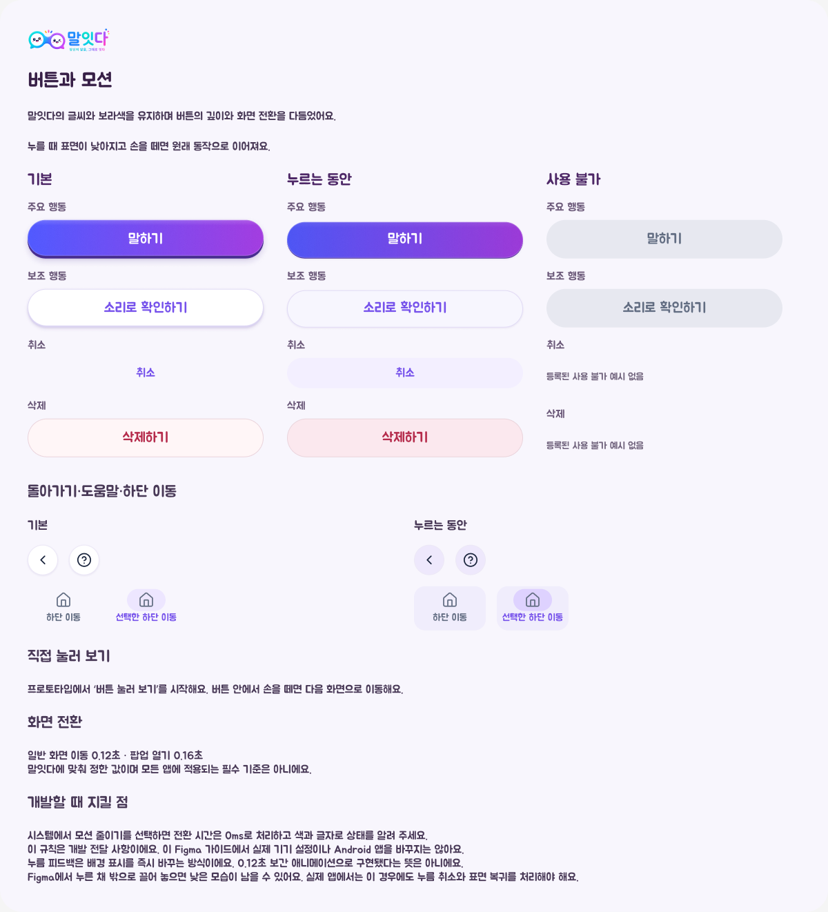

# 말잇다 버튼과 화면 모션 · Figma 개발 인계

2026-10-25 기준. **이 자료는 Figma 디자인·프로토타입 반영본이다. Android 소스와 APK에는 아직 적용하지 않았다.**

기존 주아(Jua Regular), 말잇다 로고, 보라·파랑 계열과 그림 자산을 유지하면서 버튼 누름과 화면 전환을 정리했다. 이미지와 가이드는 팀 VOICE MATE 디자인 자산이며 별도 허락 없이 재사용할 수 없다.

## 확인할 곳

- [앱 프로토타입 시작](https://www.figma.com/proto/RFGqsEDVAjLYPTwWhqOtN0?node-id=276-614&page-id=271%3A2&scaling=scale-down&starting-point-node-id=276%3A614)
- [26페이지 · 모바일 화면](https://www.figma.com/design/RFGqsEDVAjLYPTwWhqOtN0?node-id=276-661)
- [25페이지 · 네이티브 컴포넌트](https://www.figma.com/design/RFGqsEDVAjLYPTwWhqOtN0?node-id=269-2)
- [27페이지 · 버튼과 모션 가이드](https://www.figma.com/design/RFGqsEDVAjLYPTwWhqOtN0?node-id=347-43)
- [변경 전 버전 백업](https://www.figma.com/design/RFGqsEDVAjLYPTwWhqOtN0?version-id=2413986888946550526)

Figma 파일 접근 권한은 별도로 필요하다. 기존 백업 파일과 1~24페이지는 유지했다. 스크린샷 속 이름과 표현은 시안의 예시다.

## 적용한 디자인

| 대상 | Figma에서 적용한 표현 |
|---|---|
| 주요 버튼 | 얇은 윗면 하이라이트·낮은 그림자. 누르면 표면이 낮아짐 |
| 보조·아이콘 버튼 | 옅은 색과 더 낮은 그림자로 반응 |
| 텍스트 버튼·하단 메뉴 | 누르는 동안 배경이 드러남. 선택 메뉴는 보라색 표시 유지 |
| 화면·카드·체크 상태 이동 | 페이드 120ms |
| 도움말 등 모달 열기 | 페이드 160ms |
| 사용 불가 | 기존 비활성 모습 유지. 클릭 반응 없음 |

190개 화면·상태에서 742개 버튼·메뉴 인스턴스에 누름·복귀·재진입 복구를 연결했다. 메인 컴포넌트 8종의 배경을 바꾸되 같은 클릭 대상을 유지한다. 누름 표시는 즉시 상태 변경이며, 120·160ms 동안 보간되는 버튼 애니메이션은 아니다. 클릭 전환 1,324개와 모달 전환 316개에 위 시간을 적용했다. 기존 자동 전환 2개는 원래 시간과 목적지를 유지했다.

## 검증한 범위

[구조 검사 결과](verification.json)는 Figma에 저장된 값을 읽어 비교한 기록이다. 저장 구조 검사에서는 발견된 오류가 없었다.

- 190개 루트 화면의 위치·크기와 기존 컨트롤 1,134개 유지
- 비활성 컨트롤 45개에 반응 없음
- 기존 메인 컴포넌트 40개와 시작 흐름 6개 유지
- 기존 핵심 반응 1,091개 및 서비스 상태 변수 34개 전후 동일
- 버튼 누름용 UI 변수 13개 별도 사용
- 버튼·메뉴 742개와 투명 배경용 복합 상태 65개 연결 확인

브라우저에서는 시작 버튼을 누르고 손을 뗀 뒤 홈 이동, 물 그림 선택 → 뜻 확인 → 전달 → 뒤로 가기, 도움말 닫기 후 선택 유지, ‘내 표현’ 메뉴 이동, 체크 전 비활성 → 체크 후 활성 → 다음 단계 이동을 직접 확인했다.

모든 화면을 손으로 하나씩 재생한 결과는 아니다. 저장 구조 검사와 대표 흐름의 실제 재생을 구분한다. 과거 컨트롤 전체의 개별 위치·크기 원자료는 없어, 742개 변경 시점의 즉시 비교와 루트 화면·메인 컴포넌트의 원본 비교로 보존을 확인했다. 텍스트 2,210개 중 주아 집계는 2,196개이며 나머지 14개 원인은 이 검사로 확정하지 않아 ‘모든 텍스트가 주아임을 검증했다’는 뜻으로 해석하지 않는다.

## Android에 반영할 일

아래는 다음 개발 단계의 구현·검수 기준이다.

- [ ] Figma 메인 컴포넌트의 기본·누름·비활성 상태를 Compose 버튼에 대응한다.
- [ ] 손을 버튼 안에서 뗐을 때만 기존 동작을 실행한다. 취소하거나 밖에서 떼면 표면을 원상 복구한다.
- [ ] 선택·확인·거절·학생별 표현 분리 조건과 접근성 의미를 유지한다.
- [ ] 화면 이동 120ms·모달 열기 160ms를 적용하되, 기존 자동 전환 2개는 별도 동작을 유지한다.
- [ ] 시스템의 모션 줄이기 설정을 따른다. 전환이 없어도 색·문자로 선택과 활성 상태를 전달한다.
- [ ] 실제 기기에서 클릭·길게 누르기·밖으로 끌어 놓기·뒤로 가기·체크·모달 복귀를 검수한다.

**알려진 Figma 제약:** 누른 채 버튼 밖으로 끌어 놓으면 낮아진 모양이 남을 수 있다. 재진입 복구는 연결했지만 밖에서 놓는 순간의 완전 복구를 보장하지 않는다. Android에서는 별도의 누름 취소와 release-outside 처리가 필요하다. 모션 줄이기 시스템 연동도 이 프로토타입에서 구현된 기능이 아니다.

## 공식 참고

- [Figma 인터랙티브 컴포넌트](https://help.figma.com/hc/en-us/articles/360061175334-Create-interactive-components-with-variants)
- [Android 사용자 인터랙션](https://developer.android.com/develop/ui/compose/touch-input/user-interactions/handling-interactions)
- [Android MotionDurationScale](https://developer.android.com/reference/kotlin/androidx/compose/ui/MotionDurationScale)
