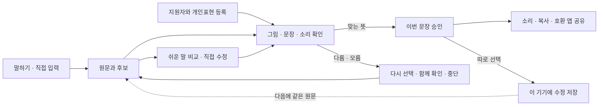

# 기본 입력 회복과 개인표현을 함께 유지

원안의 핵심은 사용자가 보낼 메시지·검색어·AI 질문을 스스로 완성하는 일이다. 기본 흐름은 말하기 또는 직접 입력에서 시작해 원문·후보 확인, 직접 수정, 본인 승인, 소리·복사·공유로 이어진다. 피드백의 개인 고유 표현·지원자 등록·그림과 소리 확인을 이 기본 흐름에 더했다.

## 이번에 연결한 기능

**수정 이력.** 문장을 확인했다는 이유만으로 원문을 저장하지 않는다. ‘다음에도 이 수정 사용’을 누르고 두 문장을 확인해 저장한 경우에만 인식 원문과 확인 문장을 기기에 남긴다. 같은 정규화 원문의 기존 기록은 최신 확인 문장으로 바뀐다. 다음 인식에서는 후보로만 제시하며 선택·승인은 다시 받는다. 직접 입력이나 저장된 문장 재사용을 새로운 음성인식 기록으로 저장하지 않는다.

**쉬운 말.** 현재는 14개의 표현·어미 규칙을 이용한다. 예를 들어 ‘휴식을 취하고 싶습니다.’를 ‘쉬고 싶어요.’로 제안한다. 원문을 함께 보여 주고, 적용하면 현재 문장을 수정한 뒤 다시 확인한다. 등록된 개인 뜻을 조용히 바꾸거나 곧바로 전달하지 않는다. 지원하지 않는 표현, 인용문·주소 등은 제안하지 않으며 숫자와 부정 표현의 변경을 막는다. 뜻이 같고 이해하기 쉬운지는 실제 이용자와 확인해야 한다.

**모름과 거절.** 일반 문장에도 ‘잘 모르겠어요’ 경로를 연결했다. 문장을 확정하지 않은 상태에서 다시 확인·다른 카드·그만하기를 선택한다. 개인 뜻 등록의 맞음·다름·모름·무응답 및 확인 방법 구분도 유지한다.

**현재 학생의 자료.** 저장한 수정은 ‘내 표현 > 저장한 수정’에서 보고, 다시 확인해 사용하거나 개별 삭제한다. 목록과 삭제는 현재 학생 범위를 확인한다. 학생 전환 때 이전 입력·승인을 먼저 지우고 새 학생을 표시한다. 사전을 불러오는 중에는 빈 사전으로 표시하지 않는다.

**다른 그림·상황의 보존.** 문장이 같더라도 서로 다른 뜻 ID의 그림·상황을 하나로 합치지 않는다. 글만 저장한 수정 이력으로 여러 그림 중 하나를 임의 선택하지 않는다.

**첫 사용.** 개인 사전에 등록한 뜻이 없어도 말하기·직접 입력을 첫 화면에서 시작한다. 개인표현 등록은 필요할 때 이어갈 수 있다. 원래 등록된 홈의 로고·캐릭터·주아·네 탭은 유지한다.

## 기획서와 피드백의 경계

기획서 본문 1~3쪽의 기본 입력 회복 및 Android Sharesheet·Intent 경로를 유지한다. 별도 검색·AI 앱 화면이나 특정 앱 자동전송을 추가해야만 원안 P0을 충족하는 것은 아니다. `F-SHARE-01`은 승인 문장을 `ACTION_SEND`와 `Intent.createChooser`로 호환 앱 선택 화면에 넘기는 기준이다. 실제 설치된 수신 앱에서 마지막 전송·검색·질문이 가능한지는 기기별로 확인해야 한다.

피드백의 대상·효과 문제는 기능 구현만으로 닫지 않는다. 기획서의 특수학급·특수학교 학생을 우선 검토하되, 그림·글·소리 중 어떤 방식으로 뜻을 확인하고 거절할 수 있는지와 필요한 도움을 구분해야 한다. 독립 완료·재발화·수정·도움·시간·오전달을 실제 과업에서 확인한다. 일반 앱의 실증 메뉴를 숨겼어도 검증 자체를 마쳤다는 뜻은 아니다.

개인 음향모델 재학습·LLM 의도 추론·IME·클라우드 동기화는 원안의 후속 범위다. 이번 기능을 그런 모델 학습으로 설명하지 않는다. AI 그림 생성도 기본 입력 회복과 별개의 추가 기능이며 실제 운영 서버·비용·보관·그림 이해 검증이 남았다.

## 개발자가 확인할 연결

| 위치 | 역할 |
|---|---|
| `CorrectionLearning.kt` | 현재 학생·원문·확인 문장·수정 버전·동의가 같은 저장 요청만 허용 |
| `VoiceCandidateOptions.kt` | 저장한 수정과 등록한 뜻을 1~3개 후보 안에서 배치하고 별도 그림·뜻 ID 보존 |
| `EasyText.kt` | 제한된 표현 제안, 원문 보존, 숫자·부정 표현·인용문 보호 |
| `SessionViewModel.kt` | 선택적 저장·재사용·삭제, 초기 사전 로딩, 학생 전환 입력 정리 |
| `U16Communication.kt` | 원문·후보 → 직접 수정·쉬운 말 → 승인 → 공유·선택적 저장 |
| `U19SavedCorrections.kt` | 학생별 저장 목록, 재확인 후 사용, 삭제 확인 |

DB 스키마는 5를 유지한다. 기존 corrections 테이블과 데이터·PIN을 자동 초기화하지 않는다. 일반 debug와 release의 실증 도구는 기본 false이며 공급자 키는 빈값이다. debug의 `CoreQaActivity`는 계측 전용·비공개·비노출이며 release에 포함되지 않는다. 실제 앱의 V2 화면에 합성 인식기와 격리 DB를 주입해 입력 흐름을 검수하는 용도다.

## 검증과 한계

단위 검사 110개, Android 계측 57개를 통과했다. 계측 57개는 기존 48개, 실제 ViewModel·DB 통합 8개, 실제 V2 화면 흐름 1개다. 화면 검사의 음성인식 결과는 합성이므로 실제 발화 인식률·지연을 뜻하지 않는다. 별도 320·430dp 100%와 320dp 200%에서 비교·모름·확인·저장 선택 상태를 확인했다. 마지막 상태·후보 보완 뒤에는 390dp 전체 흐름을 다시 실행했다. 버전·해시별 범위는 `verification.json`에 남겼다.

선행 실패도 기록했다. 최초 기능 정책 검사 16개 중 7개 실패, 학생 전환 후 원문 잔류 1개 실패, 같은 문장·다른 그림 후보 검사 8개 중 2개 실패를 각각 수정 후 통과시켰다. 계측 준비 중의 JUnit 반환형·UI 선택자·스크롤 도구 문제와 에뮬레이터 System UI 응답없음은 앱 기능 실패와 구분해 해결했다.

실제 휴대전화·실제 이용자·실제 외부 앱 수신·유료 AI 생성·전체 TalkBack/스위치 접근·정량 FPS는 미검증이다. 승인되지 않은 문장을 자동 전달하지 않는 코드·합성 시험과 현장 효과를 구분한다. 저장 전 장기 초안 복원, 기기 간 인계와 운영 배포도 별도 범위다.

최종 MainActivity에서도 기존 학생의 시험 표현 두 개가 유지되는 홈, 직접 입력의 실제 키보드, 지원하지 않는 쉬운 말의 원문 유지 상태를 확인했다. Android 공유창에는 확인 문장이 표시됐고, 앱 선택·외부 전송 없이 취소했다. 격리된 검증용 가상기기는 기본 100% 배율로 되돌리고 마이크 권한을 해제한 뒤 종료했다. 마지막 crash 버퍼는 비어 있었다.

## 설치와 개발 인수

동봉한 `말잇다_0.3.3_기본서비스와피드백_검증용.apk`는 ARM 휴대전화용 debug APK다. 소스 커밋은 `41f52de1940c71f9c4f70cee5ec16db6d48ef336`이며, 실제 동작 검사는 같은 소스의 x86 가상기기 빌드에서 수행했다. 휴대전화 설치·실제 발화 검증은 개발자가 이어서 진행해야 한다. 빌드·해시·서명은 `verification.json`과 `evidence/apk-signature.txt`에 기록했다.

가능하면 기존 PR2 브랜치를 받아 검토한다. 코드 패치는 upstream main `83330d9e06afad47f377c6f6ce41127e65fd37a3`부터 위 소스 커밋까지의 `app`·`scripts` 변경을 담은 보조 자료다. 다른 기준 버전에 바로 덮어쓰지 않는다.

기존 설치 앱의 서명이 같을 때만 업데이트 설치가 가능하다. 서명 불일치가 나오면 기존 앱을 지우지 말고 개발자의 서명 환경에서 다시 빌드한다. 이번 APK는 팀 배포용 서명이 아니며, 기존 사전·PIN·자료를 보존하는 확인이 우선이다.

첫 점검은 ‘문장 직접 입력 → 수정 → 잘 모르겠어요 → 다시 확인 → 맞는 뜻 → 소리·복사·공유 취소’ 순서로 진행한다. 저장한 수정의 재후보화는 음성인식에서 들어온 원문을 수정한 경우에 확인한다. 직접 입력은 새 음성 교정 이력으로 저장하지 않는다. AI 그림은 공급자 키 없는 상태이므로 운영 서버와 비용·보관 정책을 개발자가 연결한 뒤 별도로 검증한다.

## 다음 현장 확인

1. 실제 사용하는 메신저·검색·AI 앱 각 하나에서 승인한 문장이 올바른 입력칸에 들어오는지 확인한다. 마지막 보내기·검색·질문은 사용자가 직접 실행한다.
2. 호환 앱 미설치·공유 취소·다시 돌아오기에서 원문·수정문 보존과 복사 대체를 확인한다.
3. 실제 휴대전화의 첫 인식·반복 인식·소음·취소·다시 말하기를 측정한다. 이전 에뮬레이터의 첫 지연 편차를 실폰 성능으로 일반화하지 않는다.
4. 당사자가 원문과 제안의 같은 뜻 여부를 판단하고, 모름·거절·중단을 사용할 수 있는지 관찰한다. 보호자가 응답을 대신 확정하지 않는다.

Figma는 같은 파일의 기존 26페이지에 033 섹션을 추가했다. 16개 핵심 상태와 4개 선택 창을 편집형 Auto Layout·기존 컴포넌트로 연결했다. 고정 예시의 클릭 시안이며 실제 입력·저장·음성·발송을 실행하지 않는다. 기존 모든 상세 화면의 픽셀 단위 동기화를 완료했다는 의미는 아니다.
