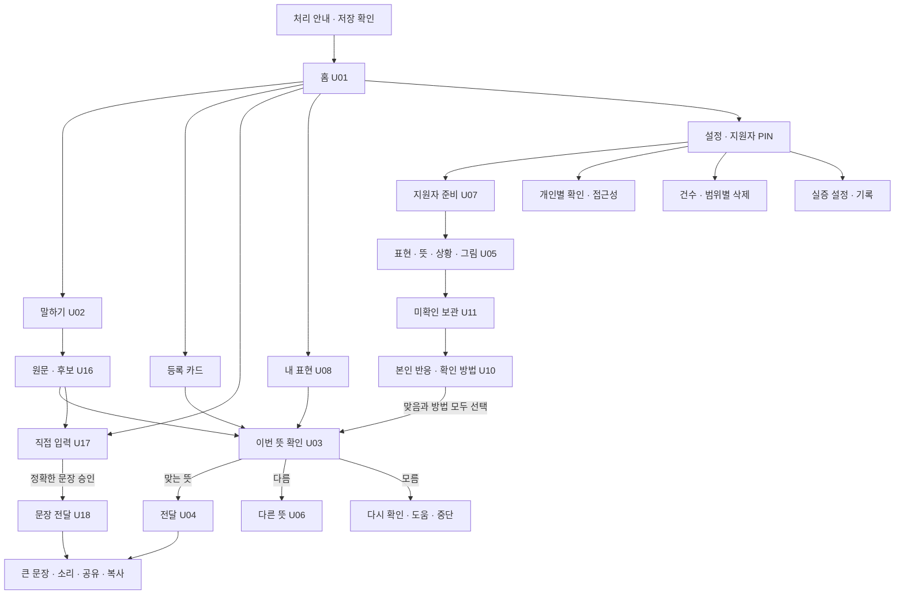
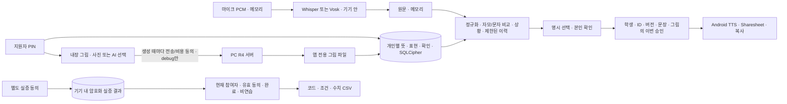

# 피드백 반영 개발 인계 · 2026-10-26

말잇다 0.3.0은 기존 디자이너의 홈·캐릭터·주아와 세 탭을 유지하고, 개인 표현을 본인의 뜻과 연결하는 흐름을 보완합니다. 공식 중간 피드백의 핵심은 의사소통의 목적, 개인별 표현과 뜻, 당사자의 확인과 거절입니다. 진단명만으로 적합성을 정하거나 발음 치료·일반 STT 대비 효과를 입증했다고 설명하지 않습니다.

[사용법과 실증 가이드](사용법과실증가이드.md) · [기능 대조](requirements.csv) · [검증명세](verification.json) · [원안 Figma](https://www.figma.com/design/RFGqsEDVAjLYPTwWhqOtN0?node-id=276-661)

## 화면과 이동

| 화면 책임 | 주요 경로 |
|---|---|
| 본인이 뜻을 고르고 전달 | 홈, 카드, 말하기, 원문·후보, 직접 입력, 맞음/다름/모름, 이번 전달 승인 |
| 지원자가 표현을 준비 | PIN → 학생 선택 → 뜻 등록·상황·그림 → 미확인 저장 → 본인 반응과 확인 방법 |
| 개인 자료 관리 | 내 표현의 사용과 관리 구분, 미확인 보관, 수정 후 재확인, 삭제, 개인별 설정과 기기 자료 관리 |
| 실증 운영 | 참여자·동의·과업·조건·환경 → 연습/실증 시도 → 관찰 응답 → 명시적 완료/중단 → 현재 참여자의 CSV |

기본 탭은 홈·내 표현·설정 세 개입니다. 지원자·실증·자료 관리가 각각 새 탭으로 늘어나지 않습니다. PIN은 기기 내 관리 화면 보호이며 보호자의 법적 권한이나 온라인 계정을 증명하지 않습니다.

## 데이터와 AI의 경계

원음 파일과 일반 말하기 전사문은 새 실증 기록에 저장하지 않습니다. 등록 표현과 뜻은 사용자가 보관하기로 선택한 자료입니다. 이전 버전의 교정 이력이 남아 있을 수 있으므로 자료 관리에서 건수와 초기화를 제공합니다. DB는 암호화하고, 사진·생성 그림은 앱 전용 파일로 보관합니다. 사진 파일까지 SQLCipher로 암호화했다고 설명하지 않습니다.

AI가 모르는 뜻을 만들어 바로 전하지 않습니다. 현재 핵심은 개인 사전과 결정 규칙입니다. AI 그림은 뜻을 확인하는 보조 자산이며, 새 그림을 받았어도 본인 확인 전에는 개인 뜻의 확인 완료로 처리하지 않습니다. 릴리스 생성 기능은 꺼져 있고, 모의 서버는 항상 같은 예시 그림을 반환합니다.

## 보완한 사항

- 개인 의미의 복수 상황·분류·즐겨찾기·검색, 개인 등록 50개 제한과 정확 중복 안내를 연결했습니다.
- 원문·후보 비교, 명시 선택, 낮은 유사도 대체, 직접 입력과 수정, 승인 취소·재확인을 연결했습니다.
- 처리 안내와 실증·AI 동의를 분리하고, 지원자 PIN·배경 재잠금·프로필/폼/비동기 결과 검사를 추가했습니다.
- 개인별 확인 방식·후보 수·TTS 속도·진동, 시스템 글자 확대 유지와 앱 200%, 고대비·가변 버튼을 적용했습니다.
- 원래 사전 분기와 정상 DB를 데이터 보존 방식으로 이관하고, 알 수 없는 형식·키 오류는 자동 초기화 없이 복구를 안내합니다.
- 새 설치에서 음성 모델이 빠지는 문제를 찾아 모델 실제 동봉과 패키징 전 해시 검사를 추가했습니다.
- 실증 코드·동의·과업·순서·기기 환경·중단·관찰 응답·CSV의 대상 필터와 실제 파일 공유를 연결했습니다.

개별 P0 90개는 코드 연결과 검증을 나눠 대조합니다. 유지 범위 80개, 온디바이스 ASR 대체 7개, 최신 대상·과업에 맞춘 조정 2개, 실제 기기 검증 계약 1개입니다. 범위가 바뀐 9개를 이전 조건 그대로의 인수 통과로 합산하지 않습니다. 연결 수를 구현률이나 이용 효과로 표시하지 않습니다.

## 시험과 전달 기준

최종 APK·소스·빌드·시험·캡처의 해시와 결과는 검증명세를 기준으로 확인합니다. 단위 검사, Room/SQLCipher·마이그레이션, 모델 새 설치, 실제 에뮬레이터 클릭, 합성 음성, 모의 이미지 반환은 서로 다른 증거입니다. 합성 음성과 모의 서버는 실제 장애 발화나 생성 품질·임상 효과를 입증하지 않습니다.

실제 이용자의 확인·거절·중단 가능성, 현장 의사소통 효과, 제조사 두 종류의 실제 휴대전화·보조기술, 실제 유료 AI 서버와 운영 인증·보관·비용 정책은 현장에서 확인해야 합니다. PR은 개발자가 검토하는 변경이며 자동 병합이나 배포를 진행하지 않습니다.
