# 말잇다 실증 운영과 앱 사용 가이드

실제 APK v0.2.5 기준 · 2026.10.25 · 치료사 검토 기본

## 말잇다, 함께 써보기

홈에서 뜻을 고르고 전달하는 방법부터
현장에서 무엇을 살펴볼지까지.

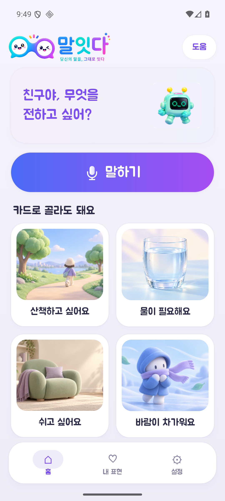

### 이번 방문의 목적

어떤 이용자와 상황에 도움이 되는지, 혼자 할 수 있는 단계와 도움이 필요한 단계를 확인해요.

### 현재 준비 기준

실제 APK v0.2.5 기준. 치료사 검토를 먼저 준비하고, 이용자 참여가 확정되면 짧은 사용 과업을 진행해요.

2026.10.25 작성 · 실제 이용자 자료가 없는 가상 예시 화면

## 홈에서 할 수 있는 일

말하기와 그림 선택 중 편한 방법으로 시작해요. 뜻이 아직 없으면 지원자와 먼저 등록해요.

- 말하기: 평소 쓰는 말을 짧게 말해요. 나온 뜻을 본인이 다시 확인해요.
- 그림 카드: 원하는 그림을 고르면 뜻 확인 화면으로 이동해요.
- 화면 아래로 더 보기: 아래로 스크롤하면 ‘지원자와 함께 등록’이 나와요.
- 홈: 일상에서 전할 말을 시작하는 곳이에요.
- 내 표현: 함께 확인한 뜻과 미확인 보관함을 살펴봐요.
- 설정: 사용할 학생, 권한, 소리, 글자 크기와 기록을 확인해요.
> 그림·문장을 본인이 알아보고 ‘맞다/아니다’를 표시할 수 있는지 먼저 살펴봐요. 지원자가 뜻을 대신 정하지 않아요.

## 기기와 진행 범위를 먼저 맞춰요

센터 방문 전에 일시·참여 인원·동행자·이용자 참여 여부를 확인해요.

### 가져갈 것

- 실증용 Android 휴대전화와 충전기, 같은 계열의 APK 설치본
- 이 사용 가이드와 빈 관찰 기록지, 시간을 잴 도구
- 참여·기록 범위를 설명할 안내와 센터가 확인한 동의 절차

### 현장 시작 전 5분 점검

- APK 버전을 확인해요. 릴리스와 디버그 앱은 데이터를 공유하지 않아요.
- 마이크 권한·한국어 음성 데이터·미디어 음량을 확인해요.
- 카드 선택 → 뜻 확인 → 전달 → 뒤로 가기를 한 번 해봐요.
- 별칭·학생별 뜻 분리·저장 후 재실행 유지 여부를 시험해요.
- 시연 중에는 기록을 꺼두고, 실제 참여 과업 직전에 기록 범위를 정해요.

### 역할을 나누면 관찰하기 쉬워요

진행자는 한 번에 한 과업만 안내해요. 관찰자는 막힌 단계와 도움 종류를 적어요. 두 사람이 어렵다면 치료사 검토와 짧은 과업부터 진행해요.

> 기기 준비가 안 되면 치료사의 설명·화면 검토로 진행해요. 프로토타입을 본 결과를 실제 APK 사용이나 이용자 실증 결과로 세지 않아요.

## 누구의 표현인지 먼저 확인해요

한 사람의 표현이 다른 사람의 뜻과 섞이지 않도록, 같은 휴대전화와 같은 앱에서 학생을 확인해요.

### 1. 설정으로 이동

홈 아래 ‘설정’에서 ‘사용할 학생 확인’을 눌러요.

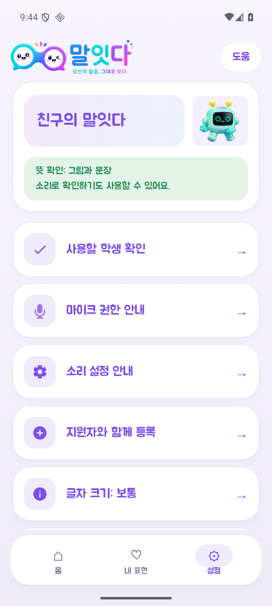

### 2. 학생 확인·전환

실명 대신 별칭을 사용해요. 새 학생은 ‘새 학생 추가’로 준비해요.

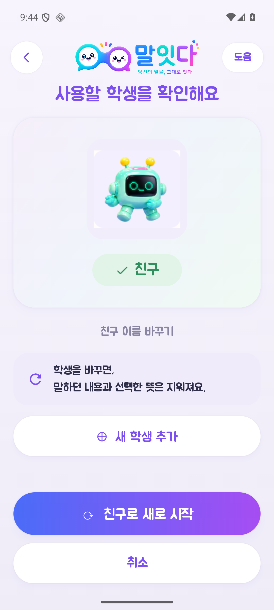

### 3. 빈 홈이면 등록부터

새 학생은 빈 사전으로 시작해요. ‘뜻 함께 등록하기’로 자주 쓰는 표현을 준비해요.

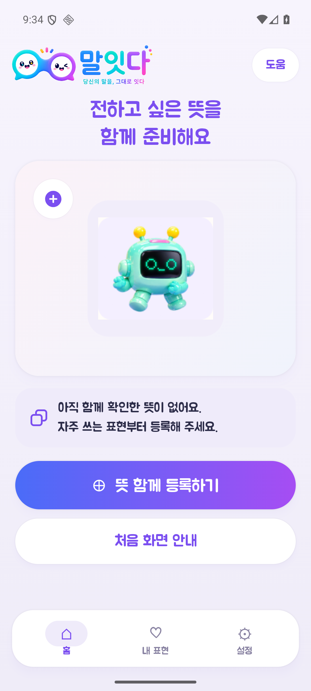

> 첫 실행의 네 그림은 기본 예시예요. 예시 화면을 실제 학생의 등록·확인 결과로 기록하지 않아요.

## 평소 표현과 전할 뜻을 연결해요

홈의 ‘지원자와 함께 등록’ 또는 빈 홈의 ‘뜻 함께 등록하기’에서 시작해요.

### 1. 표현의 주인 확인

누구의 표현인지 확인하고 해당 학생의 표현 등록으로 들어가요.

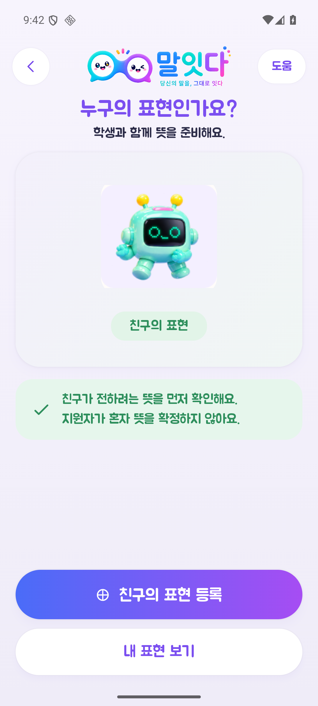

### 2. 표현·뜻·상황 입력

‘평소 쓰는 표현’에는 실제 쓰는 말을, ‘전할 뜻’에는 상대에게 보여줄 문장을 적어요.

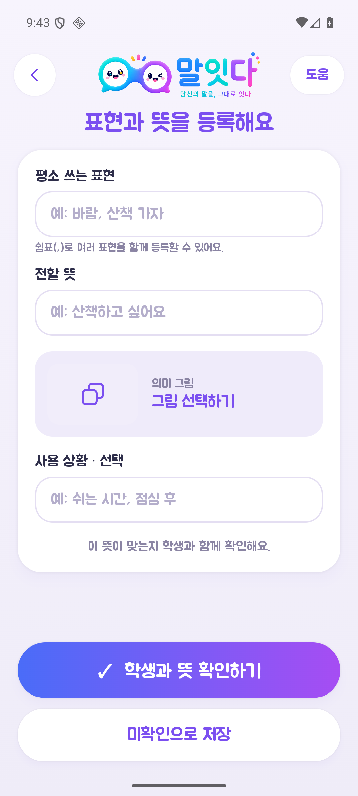

### 3. 이해할 수 있는 그림

기본 그림·그림 없음·사진 중 골라요. 사진을 쓸 때는 필요한 범위만 준비해요.

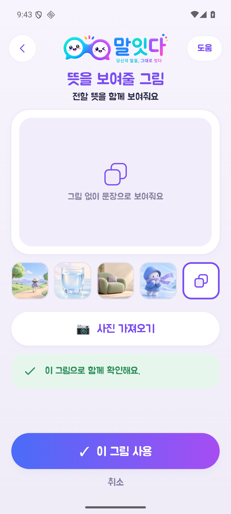

> 사용 상황은 선택 항목이에요. 표현과 뜻이 맞는지 본인과 확인해요. 다른 뜻에 이미 등록된 표현은 겹침 안내가 나와요.

## 저장과 사용 가능 상태는 달라요

등록한 내용을 본인이 알아볼 수 있는 그림·문장·소리로 함께 확인해요.

### 1. 함께 뜻 확인

그림·문장·소리로 함께 확인해요. 아직 확인하지 못했다면 등록 폼의 ‘미확인으로 저장’ 또는 이 화면의 ‘나중에 확인하기’를 눌러요.

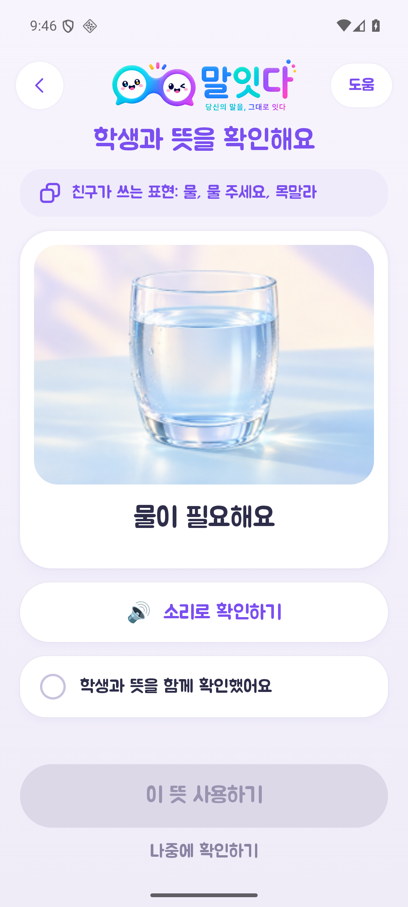

### 2. 확인한 뒤 사용

확인했다면 ‘학생과 뜻을 함께 확인했어요’를 체크하고 ‘이 뜻 사용하기’를 눌러요.

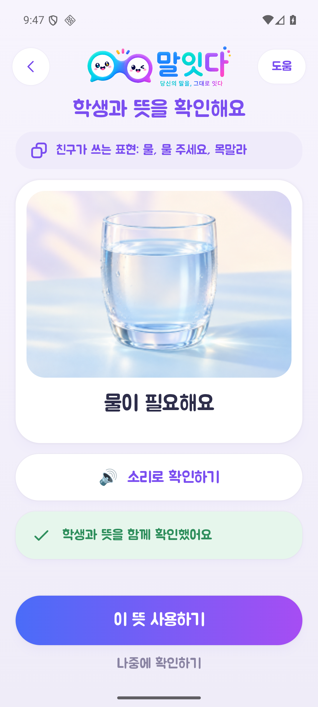

> 등록 때 함께 확인했더라도, 지금 이 말을 전할 때는 뜻을 다시 확인해요. 미확인 뜻은 홈과 음성 후보에 나오지 않아요.

사진은 기본 예시 뜻을 다시 확인하는 장면이에요. 새 뜻도 같은 확인 화면을 사용해요.

## 그림으로 고르고, 확인해서 전해요

말하기가 부담스러우면 그림 카드부터 연습해요. 첫 연습은 실증 성공 횟수에 넣지 않아요.

### 1. 그림을 골라요

홈에서 지금 전하려는 뜻의 카드를 눌러요.

### 2. 지금 뜻인지 확인해요

그림·문장을 보고 필요하면 ‘소리로 확인하기’를 써요. 맞을 때만 ‘맞아요’를 눌러요.

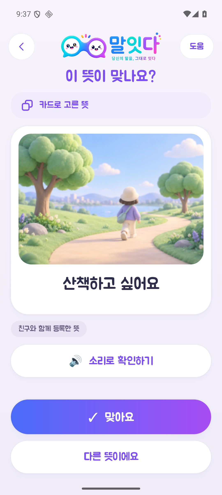

### 3. 상대에게 전해요

큰 그림·문장을 보여주거나 ‘소리로 들려주기’를 눌러요. 상대가 이해했는지도 따로 확인해요.

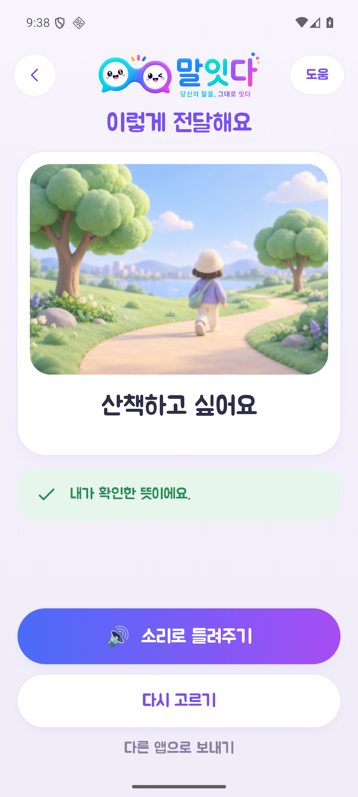

> ‘다른 앱으로 보내기’는 문장 공유창을 열어요. 버튼을 눌렀다는 사실만으로 전송 성공이나 상대의 이해를 기록하지 않아요.

## 짧게 말하고, 나온 뜻을 살펴봐요

마이크 사용이 가능하면 말하기로 시작할 수 있어요. 결과가 맞는지 확인하는 단계는 같아요.

### 1. 마이크 권한 확인

처음 사용할 때 권한 요청이 나올 수 있어요. 사용이 어렵거나 거부했다면 카드로 이어가요.

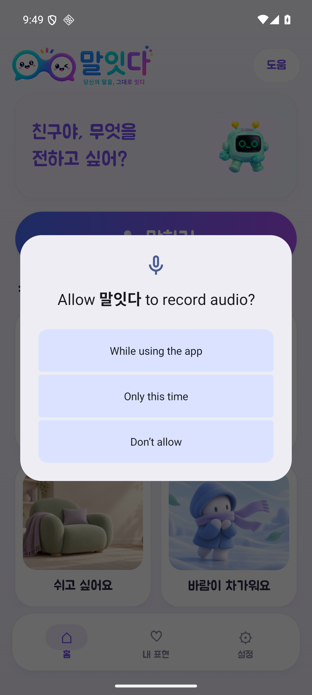

권한 문구는 휴대전화 언어에 따라 달라요.

### 2. 평소 쓰는 말로

홈 ‘말하기’에서 짧게 말해요. ‘말하기 끝내기’ 또는 최대 10초 뒤에 입력이 끝나요.

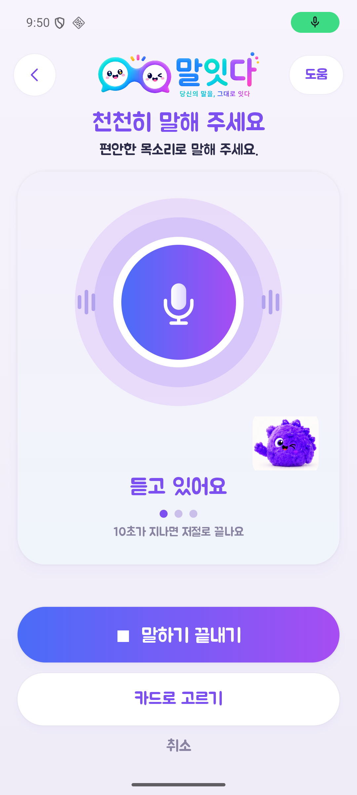

### 3. 후보가 없거나 다르면

억지로 맞다고 하지 않아요. 카드로 고르거나 지원자와 뜻을 등록하고 다시 시도해요.

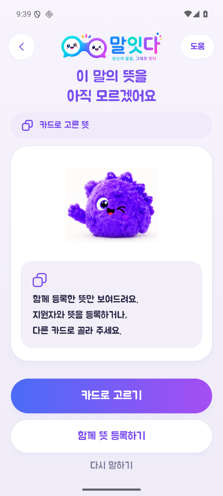

카드 선택에서 들어간 복구 화면 예시예요.

> 이 가이드의 화면 검증은 실제 발화 인식률이나 소리 품질을 검증한 결과가 아니에요. 현장 휴대전화에서 마이크·한국어 음성·대기 시간을 별도로 확인해요.

## 다르면 바꾸고, 어려우면 멈춰요

맞는 뜻을 고르는 것만큼 틀린 뜻을 거절할 수 있는지도 중요해요.

### 1. 다른 뜻이라고 알려요

‘다른 뜻이에요’를 누르면 다른 카드를 다시 고를 수 있어요.

### 2. 다시 고르거나 취소

원하는 카드가 없으면 ‘여기에 없어요’를 눌러요. ‘취소’를 누르면 이전 뜻 확인 화면으로 돌아가요.

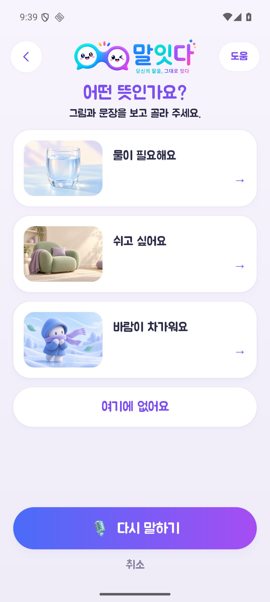

### 3. 도움을 받아 준비

카드 선택·함께 뜻 등록·다시 말하기 중 편한 방법으로 이어가요.

> APK에는 ‘확인이 어려워요’나 휴식 전용 버튼이 아직 없어요. 본인이 판단하기 어렵거나 거절하면 진행자가 입력·재생 상태를 확인하고 Android 뒤로 가기로 이전 화면에 돌아가요. ‘맞아요’를 대신 누르지 않아요.

## 앱 기록과 실제 이해를 나눠 봐요

치료사 시연은 기록을 꺼두고 진행해요. 실제 참여자 기록은 목적·범위를 정한 뒤 시작해요.

### 1. 설정 → 실증 기록

실제 과업 직전에 기록을 켜요. 과업이 끝나면 홈으로 돌아가 저장을 마쳐요.

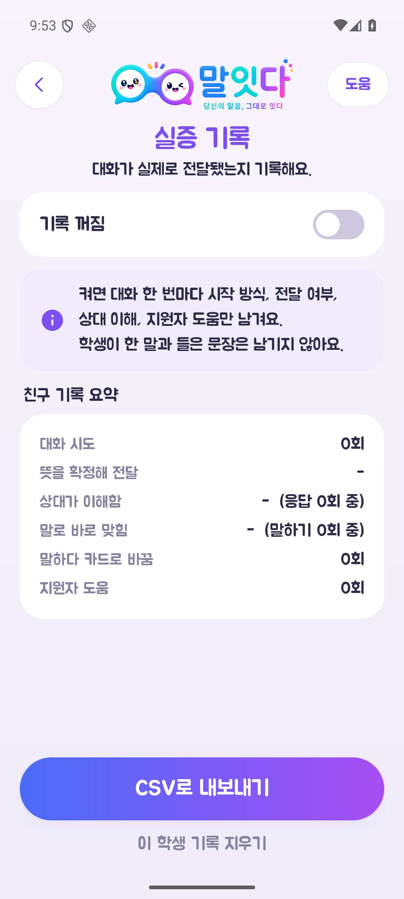

### 2. 상대 이해는 별도 표시

전달 화면 ‘실증 기록 · 지원자’에서 상대가 이해했는지와 도움 여부를 따로 남겨요.

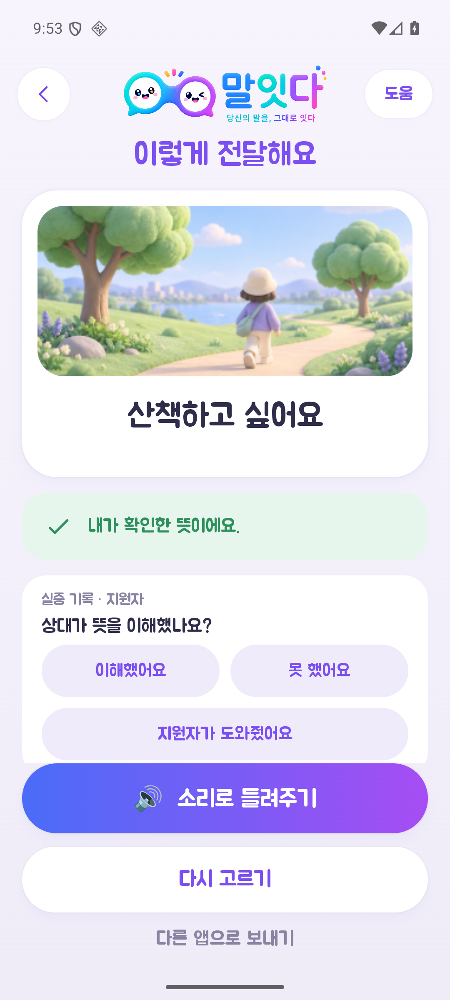

> ‘뜻을 확정해 전달’은 ‘맞아요’를 누른 기록이에요. 실제 상대 이해·소리 재생·메시지 전송 성공과 달라요. CSV는 모든 학생 이름과 기록된 뜻 문장을 텍스트 공유창으로 내보내요. 자동 파일 저장이 아니며 공유 범위를 먼저 확인해요.

예시 기록 화면은 가상 시험 기기에서 기능을 보여주는 장면이에요. 실제 이용자 결과가 아니에요.

## 치료사와 먼저 30분 살펴봐요

참여 범위가 미정일 때의 기본 운영안이에요. 실제 이용자가 없으면 치료사 역할 시연으로 기록해요.

| 제안 시간 | 함께 할 일 | 남길 결과 |
| --- | --- | --- |
| 0~3분 | 목적, APK 버전, 시연 범위 안내 | 오늘 확인할 범위 |
| 3~8분 | 평소 표현 때문에 소통이 막히는 실제 장면 듣기 | 우선 대상 조건·장면 1개 |
| 8~18분 | 함께 등록 → 홈 → 뜻 확인 → 전달 직접 사용 | 헷갈린 화면·단계 |
| 18~25분 | 다른 뜻·후보 없음·취소·학생 전환 살펴보기 | 오해·오전달 위험 |
| 25~30분 | 가장 먼저 고칠 문제 3개 합의 | 담당자·수정·재검증 일정 |

### 이렇게 물어보면 구체적이에요

- 어떤 이용자가 어떤 장면에서 쓸 수 있을까요?
- 이 그림이나 문장으로 자기 뜻인지 판단할 수 있을까요?
- 아니거나 그만하고 싶을 때 어떻게 표시하나요?
- 지원자가 등록한 뜻과 본인의 뜻이 같은지 어떻게 확인할까요?

> 확인할 가설: 개인 표현과 뜻 확인을 사용하면 낯선 상대에게 전할 때 되묻기와 뜻 판단 도움을 줄일 수 있을까요? 이번 방문에서 치료 효과를 판정하지는 않아요.

## 이용자가 참여하면 작게 시작해요

참여·동행자·센터 확인이 끝난 경우에만 진행해요. 20~30분은 제안 시간이며 피로와 의사에 맞춰 줄여요.

| 순서 | 진행 방법 | 관찰할 점 |
| --- | --- | --- |
| 준비 약 5분 | 그림·물건·몸짓 등으로 확인과 거절 방법 찾기 | 본인의 뜻을 알아볼 수 있나 |
| 함께 등록 약 5분 | 일상에서 필요한 표현 1개 준비·확인 | 뜻을 대신 정하지 않았나 |
| 작은 과업 8~10분 | 그림 선택과 말하기 중 가능한 과업 2~3개 | 혼자 한 단계·도움받은 단계 |
| 거절·복구 3~5분 | 다른 뜻 고르기 또는 취소하기 | 잘못된 뜻을 거절하나 |
| 마무리 2~3분 | 편한 방법과 다시 쓸 장면 묻기 | 본인의 선호·불편 |

### 참여 조건부터 치료사와 정해요

개인 표현의 뜻을 상대에게 전하기 어려운 이용자 중, 익숙한 방법으로 선택·거절 의사를 확인할 수 있는지 먼저 살펴봐요. 진단명만으로 사용 가능 여부를 단정하지 않아요.

### 사용법 연습과 실증 과업을 구분해요

연습에서는 버튼을 알려줘도 돼요. 관찰 과업에서는 ‘지금 필요한 것을 상대에게 알려주세요’처럼 목표만 말해요. 버튼 위치나 정답 뜻을 먼저 알려주지 않아요.

### 말로 설명하도록 요구하지 않아요

몸짓·그림·시선 등 익숙한 방법을 사용할 수 있어요. 확인·거절 방법을 찾지 못하면 독립 사용 성공으로 세지 않고 치료사 검토로 돌려요.

## 무엇을 했고, 어떤 도움이 있었나요?

완료 여부와 도움 종류를 함께 적어야 다음 수정 방향을 정할 수 있어요.

| 기록 | 기준 |
| --- | --- |
| 독립 완료 | 연습 후 과업 중 조작·뜻 선택에 관한 추가 도움 없이 완료 |
| 조작 도움 | 버튼 위치 안내, 스크롤·터치·입력 지원 |
| 뜻 판단 도움 | 후보의 뜻을 설명하거나 어떤 뜻인지 대신 알려줌 |
| 되묻기 횟수 | 상대가 뜻을 다시 물은 횟수. 조작 방법 질문은 제외 |
| 확인 불가 | 본인의 선택·거절을 확인할 방법을 찾지 못함 |
| 중단 | 본인이 그만하기로 했거나 불편·피로로 종료함 |

### 세 가지 시간은 따로 재요

- 처음 표현을 등록하는 데 걸린 시간
- 말하기 종료부터 후보가 보일 때까지의 대기 시간
- 과업 안내부터 상대에게 뜻을 전할 때까지의 시간

### 결과도 분리해요

후보에 맞는 뜻이 있었는지, 본인이 확인했는지, 상대가 이해했는지를 각각 남겨요. 앱의 전체 시도 시간은 순수 음성인식 시간과 달라요. 앱에서는 재시도가 같은 시도에 포함될 수 있어 과업 끝에 홈으로 돌아가요. 상대가 먼저 이해한 뜻을 말하거나 행동으로 보여주면 본인이 확인한 뜻과 비교해 적어요. 정답을 알려준 뒤의 반응은 구분해요.

> 뜻 판단 도움을 받아 끝낸 과업은 독립 성공으로 세지 않아요. 치료사 역할 시연과 실제 이용자 사용 결과도 합치지 않아요.

## 한 과업씩 관찰해요

실명·진단명 대신 참여자 별칭을 써요. 실제 문장이 민감하면 그대로 옮기지 말고 상황만 요약해요.

날짜 / 앱 버전 / 참여자 별칭 / 진행자: __________________________

과업과 원하는 상황 / 사용한 입력 방법: __________________________

| 확인 항목 | 표시·메모 |
| --- | --- |
| 맞는 뜻이 후보에 있었나요? | 있음 / 없음 / 확인 못 함 |
| 본인이 어떤 방법으로 확인했나요? | 말 / 그림 / 몸짓 / 시선 / 기타: |
| 조작 도움 / 뜻 판단 도움 | 각각 횟수와 내용을 적기: |
| 거절·취소 / 상대의 이해 | 성공·실패·확인 못 함을 각각 적기: |
| 되묻기 횟수 | 상대가 뜻을 다시 물은 횟수: ___회 |
| 시간 | 등록: ___초 / 대기: ___초 / 과업: ___초 |
| 최종 결과 | 독립 완료 / 도움받아 완료 / 미완료 / 확인 불가 / 중단 |

가장 막힌 장면과 다음 수정 1개: __________________________

필요한 과업 수만큼 복사해서 사용해요. 실제 참여 기록을 공개 PDF나 GitHub에 넣지 않아요.

## 무리해서 끝내지 않아도 괜찮아요

어떤 단계에서 어려웠는지 찾는 것이 목적이에요. 참여자에게 수행을 강요하거나 정답을 유도하지 않아요.

### 바로 멈출 때

- 본인이 싫다고 하거나 불편·피로·거절 신호를 보일 때
- 지금 고른 뜻이 본인의 뜻인지 확인할 방법이 없을 때
- 확인하지 않은 뜻이 전달되거나, 취소했는데 전달이 실행될 때
- 다른 학생의 표현이나 기록이 섞여 보일 때

### 참여 전 센터와 정할 것

대상·인원·시간·동행자, 참여 동의와 본인의 참여 의사, 기록할 항목·보관 위치·삭제 시점·연락 담당자를 정해요. 얼굴·음성·화면 녹화는 기본으로 수집하지 않아요.

| 관찰된 병목 | 다음 개발 |
| --- | --- |
| 버튼·순서가 어려움 | 홈 문구·터치·단계부터 줄이기 |
| 맞는 뜻이 후보에 없음 | 표현 등록·별칭·음성 입력 점검 |
| 뜻은 있으나 고르기 어려움 | 사진·선택지 수·확인 방식 조정 |
| 본인 확인 없이 전달하려 함 | 확인·거절·취소 흐름 먼저 보완 |

> 결과는 ‘성공한 과업 수/시도 수’와 구체적 장면으로 남겨요. 소수의 관찰만으로 발음 개선·치료 효과나 장애 유형 전체의 효과를 주장하지 않아요.

## 무엇을 기준으로 만들었나요?

화면 이미지는 공식 APK를 임시 시험 기기에서 실행해 새로 캡처했어요.
실제 참여자의 화면·음성·기록은 사용하지 않았어요.

### 이 문서의 버전

말잇다 APK 0.2.5 · versionCode 8 · Android 36 시험 기기. 첫 설치 기본 예시를 사용했어요. 새 학생은 빈 사전으로 시작해요.

### 여기까지 확인했어요

홈·학생 확인·등록 폼·그림 선택·뜻 확인·전달·거절·기록 메뉴의 화면과 이동을 확인했어요. 실제 발화 인식률·처리 속도·음성 재생 품질·외부 전송 성공·이용자 효과는 현장 검증이 필요해요.

### Figma와 구분해요

최근 버튼 입체감·모션, 확인이 어려울 때의 전용 경로 등은 Figma 개선 시안이에요. 이 APK에 이미 반영된 기능으로 안내하지 않아요.

> 운영 시간과 과업·관찰표는 말잇다 팀을 위한 제안안이에요. 센터와 참여 범위를 확인한 뒤 조정해요. 해외 사용자 조사 가이드는 방법 참고 자료이며 국내 법률 충족을 확인한 문서는 아니에요.

- [공식 APK v0.2.5와 릴리스 안내](https://github.com/choihyungyu0/malitda-android/releases/tag/v0.2.5)
- [과업을 통한 사용성 관찰](https://www.gov.uk/service-manual/user-research/using-moderated-usability-testing)
- [참여 동의와 자료 범위 안내](https://www.gov.uk/service-manual/user-research/getting-users-consent-for-research)
- [장애가 있는 이용자의 평가 참여](https://www.w3.org/WAI/test-evaluate/involving-users/)
