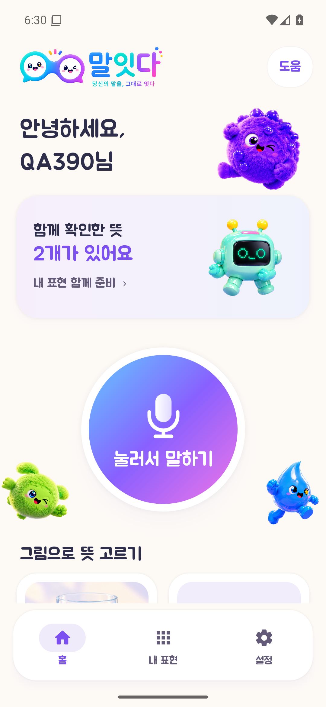
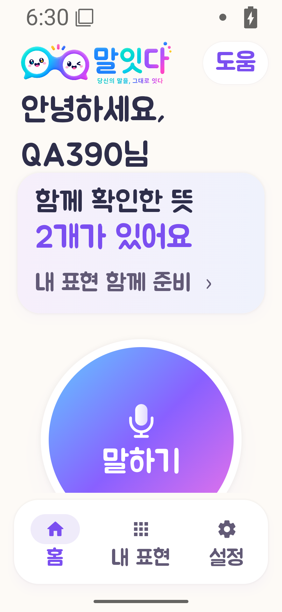
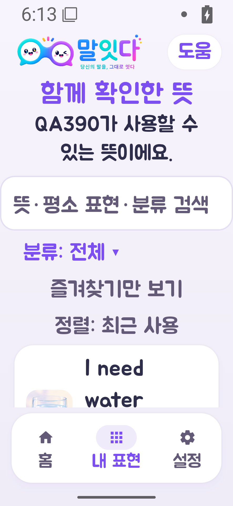
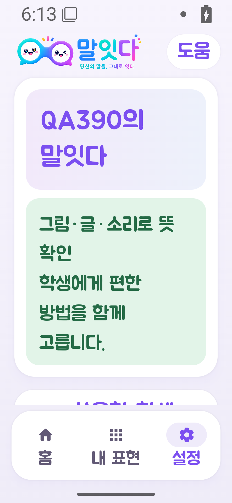
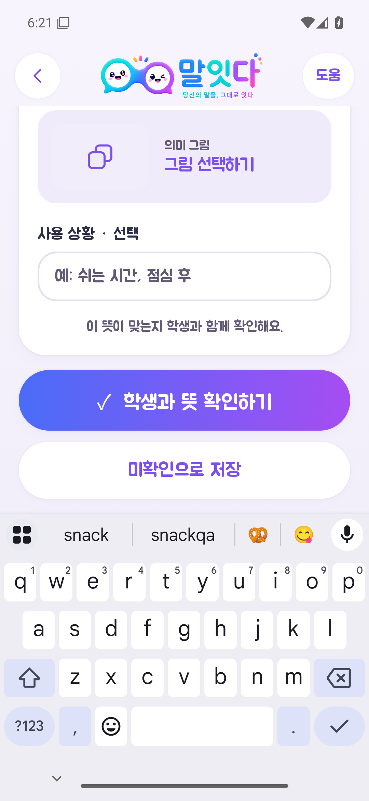
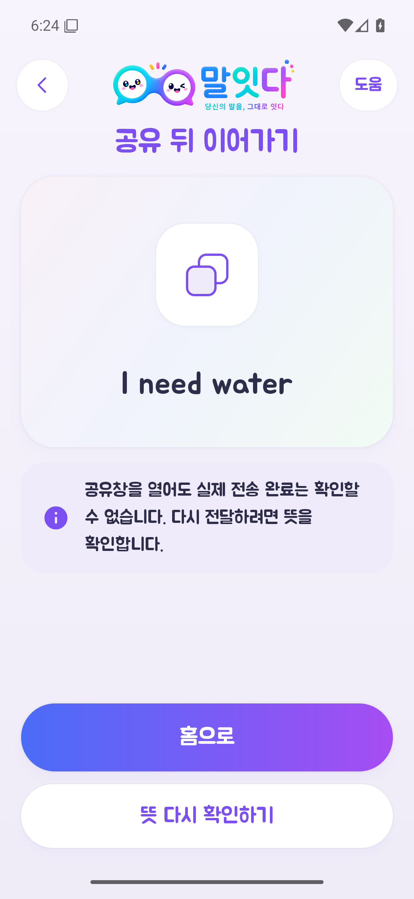

# 말잇다 모바일 디자인·사용 흐름 QA

검수일: 2026-10-26. 보완 버전: 0.3.1-debug, 코드 10. 앱 소스: `97a2db6a701cff694730ca4ec8083ec0ff10aeb2`. 대상은 기존 Android 앱이며 웹이나 Figma 전체의 완료 판정과 구분한다. 실제 사람이 참여하지 않은 합성 자료로 시험했다.

## Findings

| ID | 우선순위 | 발견한 문제와 처리 |
|---|---|---|
| MOB-01 | P1 · 남음 | 같은 최적화 음성 라이브러리를 쓰는 새 API 36·2코어 가상기기의 첫 시험에서 2.01초 합성 음성 처리에 25.651초가 걸렸다. 모델 파일이 준비된 이후 최종 계측에서는 0.617초, 반복 두 번에서는 0.548·0.452초였다. 첫 시험 조건·부하·캐시의 영향을 통제하지 않아 원인이나 실사용 개선률을 단정하지 않는다. 실제 휴대전화·마이크 지연은 미검증이다. |
| MOB-02 | P1 · 코드 통합 | 최신 개발자 변경 `83330d9`와 화면 호스트·세션 코드 두 파일이 충돌했다. 로컬에서 개발자의 그림 생성 기능과 기존 동의·승인·취소 검사를 함께 보존해 해결했다. 개발자 변경을 통합한 코드로 현재 PR을 검토한다. PR 병합·배포는 하지 않았다. |
| MOB-03 | P2 · 보완 | 큰 글씨에서 문자형 탭 아이콘과 라벨이 붙어 보였다. 24dp 벡터 아이콘과 별도 라벨·간격, 동일 너비의 탭으로 바꿨다. |
| MOB-04 | P2 · 보완 | 공유 복귀의 두 버튼이 같은 화면으로 갔고 등록 확인 뒤 홈 선택이 부족했다. 공유 뒤 ‘홈으로’와 ‘뜻 다시 확인하기’를 구분했다. 등록 확인 후 홈으로 마치거나 곧바로 뜻을 사용할 수 있다. 미확인 저장은 홈으로 돌아가며 사용 가능한 뜻으로 확정하지 않는다. |
| MOB-05 | P2 · 보완 | 일부 입력 라벨은 기본 서체를 썼고 등록 폼의 고정 행동 영역이 키보드와 경쟁했다. 앱 기본 Material 서체를 주아 Regular로 맞추고 폼과 저장 행동을 함께 스크롤하도록 바꿨다. |
| MOB-06 | P2 · 보완 | 재실행 직후 설정의 초기값 때문에 동의 화면이 잠깐 나타났다. 실제 설정이 도착하기 전에는 로딩 상태를 표시한다. 기존 동의·PIN·개인 자료는 초기화하지 않는다. |
| MOB-07 | P2 · 보완 | 200% 확대에서 한글 어절이 어색하게 나뉘는 사례가 보였다. 한국어 로케일과 Compose의 문구 단위 줄바꿈을 적용했다. 입력 원문을 바꾸거나 글자를 줄여 맞추지는 않는다. 긴 한 단어가 화면보다 넓은 모든 경우의 분리까지 막는다는 뜻은 아니다. |
| MOB-08 | P2 · 보완 | 320dp·200% 홈에서 마이크 문구가 19px만 보였다. 큰 글씨 모드의 장식·마이크·간격을 줄이고 문구를 ‘말하기’로 표시했다. 글자 크기와 접근성 이름은 유지했다. 최종 APK의 다섯 폭에서 문구 높이 99px 전체가 스크롤 영역 안에 들어오는 것을 확인했다. |

카톡에서 확인한 것은 `malitda_v2_supporter_debug_v0.2.5.apk`라는 파일명과 지연·홈 복귀 의견이다. 이미지 안의 다운로드 URL이 잘려 해당 APK의 바이트·해시는 이번에 확인하지 못했다. 연결된 Drive 검색과 확인한 로컬 다운로드 범위에서도 같은 파일을 찾지 못했다. 이번 실행 대상은 별도의 0.3.1 보완본이다.

## Summary

원안의 로고·캐릭터·원형 마이크와 홈 / 내 표현 / 설정 세 탭을 유지했다. 기기 이름이나 고정 화면 비율로 크기를 늘리지 않고 사용 가능한 폭을 사용한다. 넓은 창에서는 단일 작업에 맞춰 본문을 최대 600dp로 제한한다. 이 600dp 상한은 말잇다의 설계 선택이다.

터치 영역은 최소 48dp를 확보하고, 상태표시줄·하단 시스템 영역·키보드가 차지하는 공간을 반영한다. 시스템의 큰 글씨 설정을 축소해서 모양을 맞추지 않는다. [Android 터치·접근성 기준](https://developer.android.com/develop/ui/compose/accessibility/api-defaults), [창 크기별 배치](https://developer.android.com/develop/adaptive-apps/guides/use-window-size-classes), [안전영역과 키보드](https://developer.android.com/develop/ui/compose/system/insets), [한글·문단 줄바꿈](https://developer.android.com/develop/ui/compose/text/style-paragraph)을 확인해 적용했다.

앱의 제목·본문·버튼·입력 안내에는 기존 주아를 사용한다. Android 권한창·공유창 같은 시스템 화면은 운영체제의 서체를 사용한다. 별도의 폰트 설치나 새 디자인 도구 설치는 하지 않았다.

개발자가 추가한 직접 그림 생성 경로도 통합했다. 전달하는 검증 APK에는 공급자 키를 넣지 않는다. 개발자 전용 비공개 빌드에서만 `-PincludeDirectImageKey=true`를 명시해 기존 로컬 설정의 키를 넣을 수 있다. 키를 넣은 비공개 빌드는 공개 배포하지 않는다. 공급자 계정의 비용 한도는 별도로 관리한다. 이번 QA에서 실제 유료 그림 생성은 실행하지 않았다.

## Verification

이전 0.3.0의 검사 결과와 새 실행을 구분한다. 반응형 행렬 30장과 기능 흐름은 `19c8000d…` APK에서 검사했다. 마지막 변경은 큰 글씨 홈만 다루므로, 그 영향을 받는 다섯 홈과 일반 홈 한 개를 `7681245e…` APK에서 다시 검사했다. 최종 48개 계측도 이 마지막 APK를 사용했다.

| 검사 | 결과 |
|---|---|
| 단위 검사 | 71개 통과, 실패·오류 0 |
| 최종 Android 계측 | 48개 통과. 같은 합성 음성 시험 2회 반복은 별도 관측이며 고유 검사 수에 더하지 않음 |
| 화면 크기·확대 | 320 / 360 / 390 / 430 / 600dp × 100 / 200%, 세 탭 30장 생성·디코딩·좌표 검사. 전후 모음과 주요 원본을 시각 확인 |
| 마지막 홈 보완 | 큰 글씨 홈 5개와 일반 홈 1개 재검수. 말하기 라벨 전체 표시 |
| 넓은 창 | 추가 840×960dp에서 본문 599.91dp·중앙 정렬 확인 |
| 키보드·등록·공유·홈 복귀 | 실제 클릭 통과. 미확인 저장은 비활성 보관, 확인 후 홈은 활성화 저장, 재공유에는 재승인 필요 |
| 재실행·자료 | 재동의·자료 초기화 없이 기존 뜻·PIN 유지. 마지막 계측 후 활성 뜻 2개 보존 확인 |
| ARM Debug·R8 Release·Lint | 빌드 통과. Lint 오류 0, Debug 경고 40·Release 경고 41·힌트 각 15 |
| 모델·키·서명·APK CRC | 두 ARM ABI, 모델 15개 해시 일치, 공급자 키 빈값, Android Debug 서명·CRC 확인 |
| Git diff·패치 | 공백 검사와 최신 main `83330d9` 인덱스에 소스 패치 적용 검사 통과 |
| 실제 휴대전화·참여자·유료 AI | 미실행 |

 

 

 

그림은 가상기기의 합성 프로필이다. 상태표시줄의 시간·아이콘과 소프트웨어 키보드는 운영체제가 표시한다.

안정 ID 41개의 검사 범위와 `PASS / FAIL / BLOCKED / EXCLUDED`는 [검수 범위표](qa-coverage.csv), 빌드·산출물 해시와 실행 조건은 [검증 명세](verification.json)에 기록한다. 화면 자료는 합성 프로필만 포함한다.

## Remaining Risk

모바일 화면 보완과 서비스 전체 출시 완료는 구분한다. 음성 처리 지연 안정화가 남아 있으며, 실제 대상자의 이해·거절·오류 복구와 실제 ARM 휴대전화 두 제조사, 전체 보조기술 과업, 실제 AI 공급자와의 생성·비용·보관 검증을 수행하지 않았다. 가상기기의 합성 음성 한 개로 발화 정확도나 효과를 추정하지 않는다.

기존 Figma 홈 한 프레임과 주요 앱 화면을 대조했다. 이번 작업은 Figma 전체 프레임·컴포넌트·프로토타입을 다시 편집하거나 모든 상태의 픽셀 일치를 검증한 작업이 아니다. 세로 Android 앱의 대표 폭·확대 조합을 시험하며 모든 제조사·가로 모드·분할 화면을 검증했다고 표현하지 않는다. 실제 공유 수신자나 전송 완료는 확인하지 않는다.

PR 병합·정식 배포·팀 서명은 하지 않았다. 기존 0.3.0 APK와 보고서·원본 자료는 보존한다. 새 보완본은 설치·검토용 Debug 패키지이며 정식 제출·배포 버전과 구분한다.
